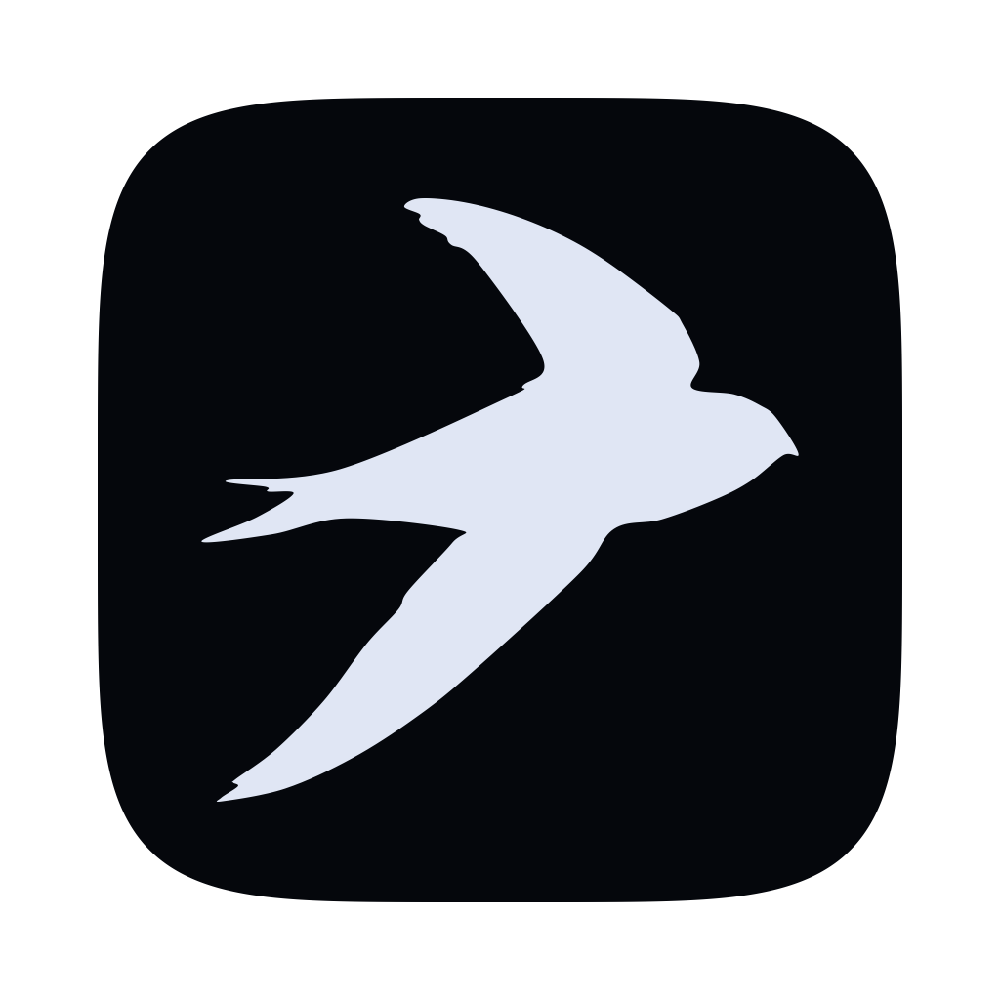
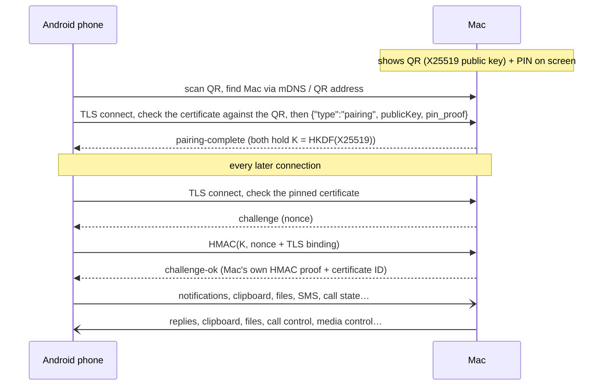

# SwiftGreen

**Android-to-Mac continuity over your own local network: notifications, SMS, calls, clipboard and file transfer. Private, open source, no account.**

[](LICENSE)
[](https://github.com/navin-labs/SwiftGreen/actions/workflows/android.yml)
[](https://github.com/navin-labs/SwiftGreen/actions/workflows/macos.yml)

<!-- Demo: docs/media/demo.gif (pairing → notification → clipboard → file). Spec: docs/media/README.md -->
<!-- Screenshots: docs/media/pairing.png, docs/media/notification-mirror.png, docs/media/clipboard.png, docs/media/file-transfer.png -->

SwiftGreen is an open-source Mac companion for Android phones. It is two native apps, a SwiftUI app for macOS (with a menu-bar item) and a Jetpack Compose app for Android, paired once with a QR code and a PIN. After that they talk over an encrypted connection on your local network: mirror and reply to notifications, read and send SMS through your phone, answer and place calls, share the clipboard and move files both ways. There is no SwiftGreen server, no cloud service, no subscription and no ads.

## Features

| Feature | Status | Notes |
|---|---|---|
| QR + PIN pairing | Working | 6-digit PIN typed on the phone; 3 tries per code |
| Notification mirroring, reply and action buttons | Working | Pick which apps mirror; reply from the Mac banner |
| Clipboard sync (text and images, both ways) | Working | Mac → phone is automatic. Phone → Mac goes through **Share → Send to Mac**, because Android 10+ doesn't let apps read the clipboard in the background. Images up to 10 MiB once base64-encoded (about 7.5 MB) |
| File transfer, phone → Mac | Working | Saved to `~/Downloads`, checksum-verified, quarantined for Gatekeeper |
| File transfer, Mac → phone | Working (tested on the reference pair) | Saved to Downloads, checksum-verified; the Mac shows it complete once the phone confirms. Android 10+ via MediaStore (no extra permission); Android 8–9 needs the storage permission |
| Browse phone storage from the Mac | Working | Needs "All files access" on the phone |
| SMS: read threads, search, send | Working | Uses the phone's SIM; dual-SIM choice |
| Calls: banner with answer/decline, dial from Mac, call log | Working | Answering needs the phone's call permissions |
| WhatsApp-style VoIP call banners | Beta | Driven by the app's notification; depends on how the app posts it |
| Media control (now playing, play/pause/seek/volume) | Working | |
| Find my phone (ring it from the Mac) | Working | |
| Reconnect after sleep / Wi-Fi change | Working | Typically a few seconds; see [ADR-003](docs/adr/ADR-003-Keepalive-and-Reconnect.md) |
| Networks that block mDNS | Working | Falls back to saved and QR addresses, then a /24 probe |
| Relay / use away from home Wi-Fi | Not supported | Local network only |

**Tested on:** a Motorola Edge 40 on Android 15, with an Apple Silicon Mac on macOS 27. That one pair is the only verified setup; *Working* means implemented and in daily use there. Other phones, Android versions, macOS versions and Intel Macs are unverified, and reports from them are welcome.

## Requirements

| | Minimum | Notes |
|---|---|---|
| Mac | macOS 15 Sequoia | Universal build (Apple Silicon and Intel; tested on Apple Silicon). macOS 15 is needed for an in-memory TLS identity import (21 ms handshakes instead of ~6 s) |
| Phone | Android 8.0 (API 26) | Android 12+ adds TLS channel binding on top of certificate pinning ([details](SECURITY.md#what-is-and-isnt-protected)) |
| Network | Both on the same LAN | Wi-Fi or Ethernet. Guest networks with client isolation block it |

## Getting SwiftGreen

### Download

| | Download | Needs |
|---|---|---|
| **Mac** | [SwiftGreen-macOS.dmg](https://github.com/navin-labs/SwiftGreen/releases/latest/download/SwiftGreen-macOS.dmg) | macOS 15 or later, Apple Silicon or Intel |
| **Android** | [SwiftGreen-Android.apk](https://github.com/navin-labs/SwiftGreen/releases/latest/download/SwiftGreen-Android.apk) | Android 8.0 or later |

Checksums: [SHA256SUMS.txt](https://github.com/navin-labs/SwiftGreen/releases/latest/download/SHA256SUMS.txt) (`shasum -a 256 -c SHA256SUMS.txt`). Every version and its notes: [Releases](https://github.com/navin-labs/SwiftGreen/releases).

1. **Mac:** open the DMG and drag SwiftGreen to Applications. It is ad-hoc signed and not notarized (the project has no Apple Developer ID), so macOS blocks the first launch: open it once, choose **Done**, then System Settings → Privacy & Security → **Open Anyway**. At the Keychain prompt, choose **Always Allow**.
2. **Android:** install the APK (let your browser or Files app install apps). SMS, Notification access and Display over other apps start blocked for a downloaded app; see [Known limitations](#known-limitations) for the one-time unlock.
3. **Pair:** on the Mac open **Settings** to show the QR code, scan it in the phone app and type the PIN.

### Build from source

```bash
git clone https://github.com/navin-labs/SwiftGreen.git
cd SwiftGreen
```

**Android** needs JDK 17+ (Android Studio's bundled JDK works) and the Android SDK for API 37 (compileSdk and targetSdk are 37):

```bash
cd android
./gradlew assembleDebug
```

```bash
./gradlew installDebug
```

The APK is at `android/app/build/outputs/apk/debug/app-debug.apk`. `installDebug` needs a phone connected with USB debugging on.

**macOS** needs Xcode 16.3 or later:

```bash
xcodebuild -project macos/SwiftGreen/SwiftGreen.xcodeproj -scheme SwiftGreen -configuration Release -destination 'generic/platform=macOS' -derivedDataPath macos/DerivedData build
```

```bash
open macos/DerivedData/Build/Products/Release/SwiftGreen.app
```

Or open `macos/SwiftGreen/SwiftGreen.xcodeproj` in Xcode and press ⌘R.

**Pair:** on the Mac, open SwiftGreen and choose **Settings** in the sidebar; the pairing code and PIN are at the top. On the phone, open SwiftGreen, tap **Pair with your Mac**, scan the code and type the 6-digit PIN shown beside it. Then grant the permissions for the features you want; see [Permissions and why](#permissions-and-why).

Details, signing and troubleshooting: [docs/BUILDING.md](docs/BUILDING.md).

## Permissions and why

Each Android permission belongs to one feature. Pairing needs only the camera, to scan the QR code; the connection itself needs none of the sensitive permissions. Decline any of them and only that feature stops working. You can change them later in SwiftGreen's Settings on the phone (Essentials and Feature permissions) or in Android Settings.

| Permission | Used for | Optional? |
|---|---|---|
| Notification access | Reading notifications to mirror them to the Mac, and sending your replies and action-button taps back | Yes. Without it, no notification mirroring |
| Notifications (Android 13+) | The phone's own "connected" status and file-transfer progress | Yes |
| SMS (read, send) | Showing your text threads on the Mac and sending texts from it, through your phone's SIM | Yes |
| Call log | Recent calls on the Mac | Yes |
| Phone, call control (read phone state, make and answer calls) | Incoming-call banners on the Mac, dialling from the Mac, answering or declining from the Mac | Yes |
| Contacts | Names instead of numbers for calls and texts, and favourites on the Mac | Yes |
| Camera | Scanning the pairing QR code, once. Frames are decoded on the phone | Needed to pair by QR |
| All files access (Android 11+) or storage (Android 8–10) | Browsing the phone's folders from the Mac. Android 8–9 also needs storage to save files sent from the Mac; Android 10+ saves them to Downloads without it | Yes |
| Display over other apps | Letting **Answer** on the Mac open a VoIP app's call screen, which Android otherwise blocks from the background | Yes |
| Nearby devices (Bluetooth, Android 12+) | Noticing the Mac's Bluetooth beacon so the phone reconnects as soon as the Mac is near. Declared "never for location" | Yes |
| Unrestricted battery | Keeping the connection alive with the screen off | Yes, but some phones then drop the connection in the background |

Granted automatically at install: network access and Wi-Fi state (the local connection, plus the album-art lookups listed under [Security and privacy](#security-and-privacy)), multicast (mDNS discovery), a foreground service (the connection), starting at boot when sync is on, vibration, audio settings (muting the call microphone), and package visibility (showing app names and icons for mirrored notifications and the per-app filter).

## How it works



- **One TLS connection** from the phone to the Mac, newline-delimited JSON on top. The Mac finds itself on the network with Bonjour (`_swiftgreen._tcp`); the phone falls back to known addresses when a router blocks mDNS.
- **Identity is the pairing key, plus a pinned certificate.** Both sides prove they hold `K` on every connection. The phone also pins the Mac's certificate, whose fingerprint is in the QR, and sends nothing to a host presenting another. On Android 12+ the proofs are additionally bound to the TLS session.
- **The Mac drives keepalive** (a ping every 30 s) so the phone can sleep between pings.

The protocol as built: [docs/protocol/PROTOCOL.md](docs/protocol/PROTOCOL.md). Design decisions and the alternatives we turned down: [ADR-001 transport](docs/adr/ADR-001-Transport-Decision.md), [ADR-002 pairing and auth](docs/adr/ADR-002-Pairing-and-Authentication.md), [ADR-003 keepalive and reconnect](docs/adr/ADR-003-Keepalive-and-Reconnect.md).

## Security and privacy

What the code does, stated no stronger than the code and tests support:

- **Your data stays on your network.** Notifications, messages, clipboard and files go phone ↔ Mac over TLS on the LAN. There is no SwiftGreen server and no account, and SwiftGreen's own code has no analytics or ads.
- **Two exceptions leave your network, both from the phone:** album artwork is fetched from the URL your music app provides, or looked up by track and artist on Apple's iTunes Search API; and the QR scanner is Google's ML Kit, whose terms let it send usage metrics to Google. Neither involves your messages, notifications, clipboard or files. On the Mac, **Open in WhatsApp** on a call or contact opens a `wa.me` link with that number in your browser, only when you click it.
- **Only your paired phone can talk to your Mac.** Until a device proves it holds the pairing key, the Mac ignores everything it sends except the pairing or challenge message. A stranger on the same Wi-Fi can't post notifications, set your clipboard or send files, and connecting to the Mac doesn't knock your phone off.
- **Your phone only talks to your Mac.** It checks the Mac's certificate against the one named in the pairing QR before sending a PIN proof, an authentication proof or any data.
- **Files can't be written outside Downloads.** Names are cut to their last path component; nothing is saved unless its SHA-256 matches; existing files are never overwritten.
- **Keys:** the pairing key sits in the macOS Keychain on the Mac. On the phone it is sealed with AES-256-GCM under an Android Keystore key, in app-private storage excluded from backups. The Mac's TLS key is a per-install file (mode 0600), not in the Keychain.

Full threat model, what is *not* protected, and how to report a vulnerability: [SECURITY.md](SECURITY.md). The project's own security review and its fixes: [docs/SECURITY-REVIEW.md](docs/SECURITY-REVIEW.md). There has been no third-party audit.

## Known limitations

- **The Mac app is ad-hoc signed and not notarized.** This project has no Apple Developer ID. A copy you build yourself opens normally; a downloaded copy is blocked on first launch, and on macOS 15 and later right-click → Open no longer gets past it. Open the app once, choose **Done**, then go to System Settings → Privacy & Security and click **Open Anyway**.
- **After installing a new version of the Mac app, macOS asks once whether SwiftGreen may use its Keychain item** (the pairing key). Each build of an ad-hoc signed app counts as a new app to the Keychain. Choose **Always Allow**: plain **Allow** doesn't let SwiftGreen connect.
- **A downloaded APK starts with SMS, Notification access and Display over other apps blocked.** Android treats them as restricted settings for apps installed from a downloaded file (seen on the reference phone, Android 15; phone and call-log permissions were not blocked). Display over other apps is what the app's **Answer calls from Mac** setting turns on. Tap the blocked permission once so Android shows **App was denied access**, close App info completely, reopen it, then ⋮ → **Allow restricted settings** and grant the permissions. The menu item only appears after that first denial. Installs from Android Studio or `adb` skip this.
- **One phone per Mac.** To switch phones, unpair first (Mac: Settings → Unpair…).
- **Upgrading from a build before certificate pinning:** a phone paired earlier pins the Mac's certificate on its first reconnect. On Android 8–11 that one connection isn't protected against a relay; re-pair to remove the gap ([SECURITY.md](SECURITY.md#what-is-and-isnt-protected)).
- **If the phone's pairing key can't be read** (for example after restoring a backup onto a new phone), the phone says so and asks you to pair again.
- Phones from vendors with aggressive battery management (Xiaomi, Oppo, Vivo, some Samsung) may stop the background service. The app walks you through the battery settings, but results vary by vendor.
- Same local network only. No relay, no internet mode.

## Troubleshooting and FAQ

[docs/TROUBLESHOOTING.md](docs/TROUBLESHOOTING.md) covers "phone can't find the Mac", "connected but nothing syncs", "keeps disconnecting" and "macOS won't open the app".

**Is it free?** Yes, all of it, under Apache-2.0. There are no paid tiers, ads or in-app purchases.
**Does it work over cellular or away from home?** No. Both devices must be on the same local network.
**Does it need an internet connection?** No. Pairing and sync work on a local network with no internet access.
**Does it work with an iPhone?** No, the phone side is Android only.
**Windows or Linux?** No, the desktop side is macOS only.

## Documentation

| Document | What it covers |
|---|---|
| [Building](docs/BUILDING.md) | Toolchains, build and test commands, signing a release APK |
| [Testing](docs/TESTING.md) | Automated suites, what they cover, manual checks |
| [Troubleshooting](docs/TROUBLESHOOTING.md) | Discovery, sync, disconnects, Gatekeeper, failed transfers |
| [Security](SECURITY.md) | Threat model, what is and isn't protected, reporting a vulnerability |
| [Security review](docs/SECURITY-REVIEW.md) | The project's own findings, fixes and accepted risks |
| [Architecture](docs/ARCHITECTURE.md) | Components on each side, where data is stored, test strategy |
| [Protocol](docs/protocol/PROTOCOL.md) | Every message on the wire, pairing and authentication, file transfer |
| ADRs | [Transport](docs/adr/ADR-001-Transport-Decision.md), [pairing and authentication](docs/adr/ADR-002-Pairing-and-Authentication.md), [keepalive and reconnect](docs/adr/ADR-003-Keepalive-and-Reconnect.md), each with the alternatives turned down |
| [Contributing](CONTRIBUTING.md) | Setup, change rules, tests to run, pull requests |

## Engineering notes

- **Protocol:** one TLS connection, newline-delimited JSON. Pairing uses X25519 + HKDF-SHA256 with a PIN proof; every reconnect is a mutual HMAC challenge, bound to the TLS session on Android 12+ and backed by certificate pinning on every version.
- **Tests:** 57 Android JVM tests and 29 macOS XCTests, including shared crypto test vectors asserted by both apps and regression tests for the security fixes. CI runs both suites, Android lint, and debug and release builds of both apps on every push to `main` and every pull request, plus a repository hygiene check for key material, personal paths and logging that could leak message content.
- **Scope:** local network only, one phone per Mac, no server. Features that would need a cloud service are out of scope.

## Getting help and contributing

- Something broken? [Open an issue](https://github.com/navin-labs/SwiftGreen/issues/new/choose) with your phone, Android version and macOS version.
- Security issue? **Don't** open an issue. See [SECURITY.md](SECURITY.md).
- Want to contribute? [CONTRIBUTING.md](CONTRIBUTING.md). Code of conduct: [CODE_OF_CONDUCT.md](CODE_OF_CONDUCT.md).

## License

Apache License 2.0. See [LICENSE](LICENSE) and [NOTICE](NOTICE). Copyright 2026 Navin Rana.
